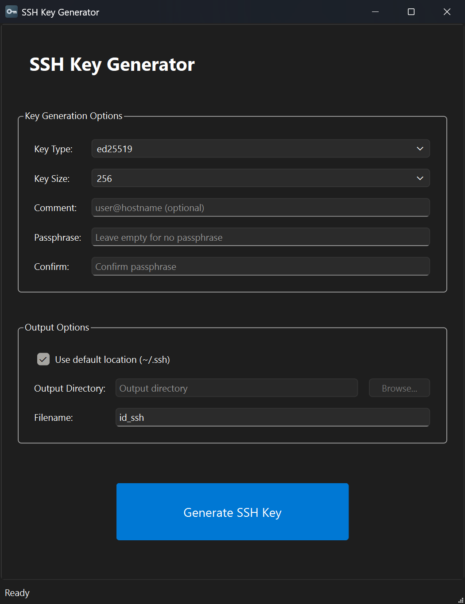
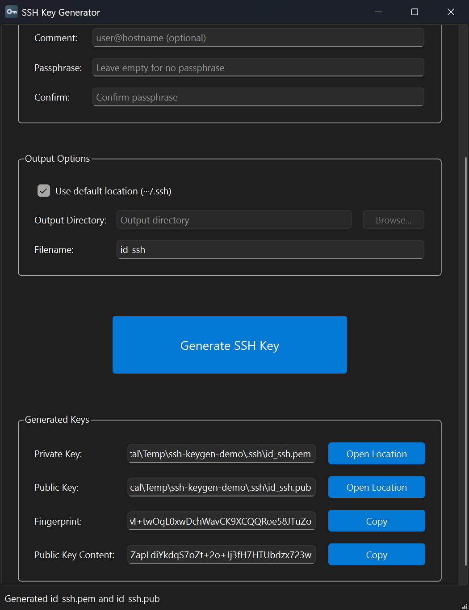

# SSH Key Generator

[](https://github.com/haseebn19/ssh-keygen/actions/workflows/ci.yml)


A desktop application for generating SSH keys and displaying their public keys and fingerprints.

## Screenshots





## Features

- **Multiple Algorithms**: ED25519, RSA, and ECDSA key support
- **Key Size Options**: 2048, 3072, or 4096 bits for RSA, and 256, 384, or 521 for ECDSA
- **Passphrase Protection**: Optional encryption for private keys
- **Fingerprint Display**: SHA256 fingerprint generation
- **Quick Copy**: One-click copy for public key and fingerprint
- **Overwrite Protection**: Asks before replacing an existing key with the same name
- **Dark/Light Theme**: Follows the system theme

## Prerequisites

- Python 3.11+

## Installation

```bash
git clone https://github.com/haseebn19/ssh-keygen.git
cd ssh-keygen

# Create virtual environment
python -m venv .venv

# Activate virtual environment
# On Windows:
.venv\Scripts\activate
# On macOS/Linux:
source .venv/bin/activate

# Install the package
pip install .
```

## Usage

```bash
ssh-keygen-gui
```

The command is named `ssh-keygen-gui` so it does not replace OpenSSH's `ssh-keygen`.

1. Select the algorithm and key size
2. Optionally enter a comment and passphrase
3. Choose the output location or use the default (`~/.ssh`)
4. Click **Generate SSH Key**
5. Copy the public key or open the file location

The private key is saved as `<filename>.pem` in PKCS#8 format and the public key as `<filename>.pub`. OpenSSH only loads keys with its default names automatically, so point it at the key with `ssh -i ~/.ssh/id_ssh.pem user@host` or an `IdentityFile` entry in `~/.ssh/config`.

## Development

### Setup

```bash
# Create and activate virtual environment
python -m venv .venv
# On Windows:
.venv\Scripts\activate
# On macOS/Linux:
source .venv/bin/activate

# Install in editable mode with dev dependencies
pip install -e ".[dev]"
```

### Testing

```bash
pytest
```

With coverage:

```bash
pytest --cov
```

### Linting

```bash
ruff check .
ruff format --check .
```

## Building

Create a standalone executable:

```bash
pyinstaller main.spec
```

The `.exe` will be in the `dist/` folder.

## Project Structure

```text
ssh-keygen/
+-- src/ssh_keygen/
|   +-- main.py               Entry point
|   +-- utils.py              Resource paths and filename cleanup
|   +-- resources/            Application icons
|   +-- core/key_generator.py Key generation and fingerprints
|   +-- ui/main_window.py     PyQt6 window
+-- tests/                    pytest suite
+-- resources/                README screenshots
+-- pyproject.toml            Package, Ruff, and pytest configuration
+-- main.spec                 PyInstaller configuration
```

## Credits

- [cryptography](https://cryptography.io/) - Key generation
- [PyQt6](https://www.riverbankcomputing.com/software/pyqt/) - User interface

## License

This project is licensed under the [MIT License](LICENSE).
